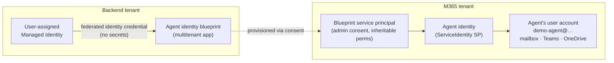
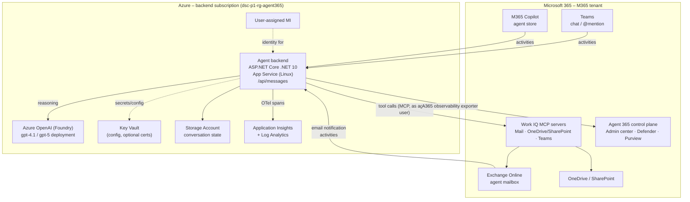
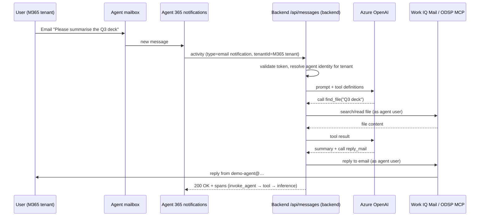

# Solution Architecture – Agent 365 Demo Agent

> Status: **Draft v0.1** (2026-11-14) · Owner: project sponsor · Stack: .NET 10, Azure OpenAI (Foundry)

## 1. Goal

Showcase Microsoft Agent 365 with an agent that has **its own identity** (Entra Agent ID + its own
user account): it can be found in the directory, has a mailbox and Teams presence, and is governed
like an employee — while its "brain" runs in a separate, multitenant backend.

The agent itself is intentionally simple. It can:

| # | Capability | Channel / mechanism |
|---|------------|---------------------|
| C1 | Receive emails sent to its own mailbox | Agent 365 email notifications → messaging endpoint |
| C2 | Send emails (reply / new) as itself | Work IQ Mail MCP server (Agentic-User mode) |
| C3 | Read files (OneDrive / SharePoint) | Work IQ OneDrive & SharePoint MCP server |
| C4 | Chat in Teams (1:1, group chat, @mention) | M365 Agents SDK activity protocol |
| C5 | Be used from Microsoft 365 Copilot | Published agent in the Copilot agent store |
| C6 | Be observable and governable | Agent 365 observability → Defender, Purview, M365 admin center |

## 2. Tenants

IDs are never committed. They live in a local, git-ignored `.env` (see `.env.example`).

| Role | Environment variables | Contains |
|------|-----------------------|----------|
| **Backend / publisher tenant** | `AZURE_TENANT_ID`, `AZURE_SUBSCRIPTION_ID` | Azure subscription with all compute, LLM, secrets, telemetry. Home of the **multitenant agent blueprint**. |
| **Customer / M365 tenant** | `A365_TENANT_ID` | Blueprint service principal (consented), **agent identity**, **agent's user account** (mailbox, Teams), licenses, Teams app / Copilot catalog entry. Frontier preview enabled, Copilot licenses available. |

The backend is designed **multitenant**: nothing in the backend is bound to the customer tenant.
Every incoming activity carries the tenant ID; the backend resolves tokens for *that* tenant.
Adding a second customer tenant = consent the blueprint there + create an agent instance; no redeploy.

## 3. Identity model



* **Blueprint** – the "kind of agent". Holds the credential (FIC → managed identity of the backend,
  so no secret anywhere), declared/inheritable permissions (Work IQ Mail, OneDrive/SharePoint, Teams),
  and the messaging endpoint. Registered **multitenant** in the backend tenant.
* **Agent identity** – tenant-local service principal in the M365 tenant, created from the blueprint.
  Has its own sponsor, Conditional Access, audit trail.
* **Agent's user account** (Agentic-User mode, Frontier) – gives the agent a real mailbox, Teams
  presence and OneDrive; licensed with Microsoft 365 Copilot (+ E5/E7 or Agent 365 for observability).

Token flow at runtime (Agentic-User mode):
`Managed identity token (T1)` → `blueprint token for tenant T2 (FIC)` → `agent identity token` →
`agent user token` → call Work IQ MCP / Graph **as the agent user**.
The Agent 365 SDK (`Microsoft.Agents.A365.*`) encapsulates this chain.

> **Phase 0 finding (2026-11-14) – revised identity placement.** `a365 setup` creates the blueprint in
> the tenant of the signed-in admin, and Agent 365 / Frontier is enabled only in the M365 tenant, not
> in the backend tenant. Therefore:
>
> 1. The blueprint is created **in the M365 tenant** (by `a365 setup all --aiteammate --m365`) and
>    marked multitenant so further customer tenants can be onboarded later.
> 2. Credential, step 1: the CLI-generated client secret, stored **only** in the backend Key Vault
>    (`dsc-p1-kv-agent365`) and read by the App Service via managed identity.
> 3. Credential, step 2 (hardening): a federated identity credential on the blueprint that trusts the
>    backend user-assigned managed identity across tenants; the secret is then deleted.
>
> The backend code stays the same in every variant; only configuration differs.

## 4. Component architecture



### 4.1 Backend (`src/DemoAgent`)

ASP.NET Core minimal host, built on:

* **Microsoft 365 Agents SDK** – hosting, `/api/messages`, activity routing, turn state.
* **Agent 365 SDK** – agentic auth (blueprint → agent identity → agent user), notification
  handlers (email, Word comments, lifecycle events), tooling (Work IQ MCP client), observability.
* **Microsoft.Extensions.AI / Semantic Kernel (Agent Framework)** – LLM orchestration with
  Azure OpenAI and MCP tools exposed as functions.

Logical structure:

```
src/DemoAgent/
  Program.cs                 host, DI, auth, observability
  Agent/DemoAgent.cs         AgentApplication: routes message / email / lifecycle activities
  Agent/Handlers/
    TeamsMessageHandler.cs   C4/C5 – chat turns (Teams & Copilot share the same handler)
    EmailHandler.cs          C1 – incoming email notification → LLM → reply (C2)
    LifecycleHandler.cs      agent user created/deleted, installed in team, etc.
  Agent/Tools/               MCP tool registration (Mail, ODSP), allow-list
  Agent/Prompts/system.md    persona & guardrails
  appsettings.json           no tenant-specific values; all per-tenant data comes from the activity
```

### 4.2 Behaviour (deliberately minimal)

| Trigger | Behaviour |
|---------|-----------|
| Teams / Copilot message | LLM answers; may call tools: *search my files*, *read file X*, *send email to Y*. |
| Email to agent mailbox | Summarise the mail, optionally read attached/linked file, **reply by email** as the agent. |
| "Send me a summary of file X by mail" (Teams) | Read file via ODSP MCP → summarise → send mail via Mail MCP. Showcases all capabilities in one flow. |
| Agent installed / user created | Send a welcome message in Teams and a "hello" email to the sponsor. |

### 4.3 Key flow – email in, email out



## 5. Azure resources (backend tenant)

All provisioned via Bicep (`infra/`), deployed via GitHub Actions (OIDC, no stored secrets).
Because the agent lives in a different tenant, `a365.config.json` uses `"needDeployment": false`
and the CLI only manages the blueprint/registration, not the Azure infrastructure.

Naming convention: `dsc-p1-<type>-agent365` (storage accounts without dashes: `dscp1stagent365`).
Region: **Switzerland North** for everything. Tags: `workload=agent365`, `environment=demo`, `owner=dsc`.

| Resource | Name | SKU (demo) | Purpose |
|----------|------|-----------|---------|
| Resource group | `dsc-p1-rg-agent365` | – | container |
| App Service plan | `dsc-p1-asp-agent365` | B1 Linux | |
| Web App (.NET 10) | `dsc-p1-app-agent365` | – | hosts `/api/messages` (HTTPS, always-on) |
| User-assigned managed identity | `dsc-p1-app-agent365-uaid` | – | access to AOAI / KV / Storage; later FIC to blueprint |
| Key Vault | `dsc-p1-kv-agent365` | Standard, RBAC | blueprint client secret (until FIC) |
| Storage account | `dscp1stagent365` | Standard LRS | turn / conversation state (blob) |
| Log Analytics | `dsc-p1-log-agent365` | PAYG | |
| Application Insights | `dsc-p1-appi-agent365` | – | technical telemetry |
| GitHub deploy identity | `dsc-p1-github-agent365-uaid` | – | OIDC federated credential for GitHub Actions |
| Azure OpenAI (**existing, reused**) | `dsc-p1-model-eo3aez4xziljo` in `dsc-p1-rg-msftaihub` | S0 | new deployment `agent365-chat` (`gpt-5.4-mini`, GlobalStandard) |

## 6. Security & governance

* **No secrets in code or config**: blueprint secret only in Key Vault (target: replaced by FIC);
  GitHub → Azure via OIDC; AOAI/Storage/KV via RBAC.
* **Least privilege**: blueprint declares only Mail (read/send), Files.Read (ODSP), Teams chat;
  admin consent by a Global Admin of the M365 tenant.
* **Tool allow-list** in code: the LLM can only call the enumerated MCP tools; no delete operations.
* **Outbound email guardrail**: the agent sends mail (replies, proactive messages) only to the
  M365 tenant's own verified domains.
* **Sponsor** assigned to blueprint and agent identity; Conditional Access applies to agent identity.
* **Observability**: every turn emits an `invoke_agent` root span → visible in Defender,
  Purview and M365 admin center (needs ≥1 user with E7 or Agent 365 license).
* **Inbound validation**: Agents SDK JWT validation of every activity; tenant ID taken from token.
* Public GitHub repo: contains **no** tenant or subscription IDs, credentials or generated config.
  IDs live in a local `.env` and in GitHub Actions secrets; `a365.config.json` and
  `a365.generated.config.json` are git-ignored.

## 7. Multitenancy

| Concern | Approach |
|---------|----------|
| Identity | Blueprint is multitenant; each customer tenant gets its own agent identity + user. |
| Token acquisition | Per activity, using the activity's tenant ID (Agent 365 SDK). |
| State | Partitioned by `tenantId/conversationId`. |
| Config | No tenant IDs in `appsettings`; optional allow-list of onboarded tenants. |
| Telemetry | `tenant.id` attribute on all spans. |

## 8. Architecture decisions

| ID | Decision | Rationale |
|----|----------|-----------|
| AD-01 | .NET 10 + M365 Agents SDK + Agent 365 SDK | Most mature samples, clean MI/FIC support. |
| AD-02 | Azure OpenAI in Foundry | Stays in backend tenant, RBAC via MI, EU data residency. |
| AD-03 | Agentic-User mode (AI teammate) | Required for own mailbox, Teams presence, email notifications. Tenant is Frontier-enabled. |
| AD-04 | Work IQ MCP for mail & files instead of raw Graph | Admin-governed tools, showcases Agent 365 tooling; Copilot licenses available. |
| AD-05 | Blueprint in the M365 tenant (multitenant flag), secret in Key Vault → later cross-tenant MI FIC | Agent 365 is enabled only in the M365 tenant; the CLI creates the blueprint there (Phase 0 finding). |
| AD-06 | App Service over Container Apps | Simplest always-on HTTPS host for a demo (confirmed by the sponsor). |
| AD-07 | `needDeployment: false`, infra via Bicep | Azure resources live in a different tenant than the agent registration. |
| AD-08 | Reuse existing Azure OpenAI account `dsc-p1-model-eo3aez4xziljo` | Sponsor decision; add a dedicated deployment instead of a new account. |
| AD-09 | Reactive **and** proactive behaviour | Sponsor decision: welcome mail on install, follow-up mails. |
| AD-10 | Branch + PR per phase | Sponsor decision. |
| AD-11 | Agent identity + agent user created via Microsoft Graph (`scripts/create-agent-user.py`) | Admin center activation blocked by a SKU mismatch in the default policy template (R4); support ticket open. |
| AD-12 | No Conditional Access policy for the agent identity in this tenant | No Entra ID P1/P2 (R5); report-only policy script kept for tenants that have it. |
